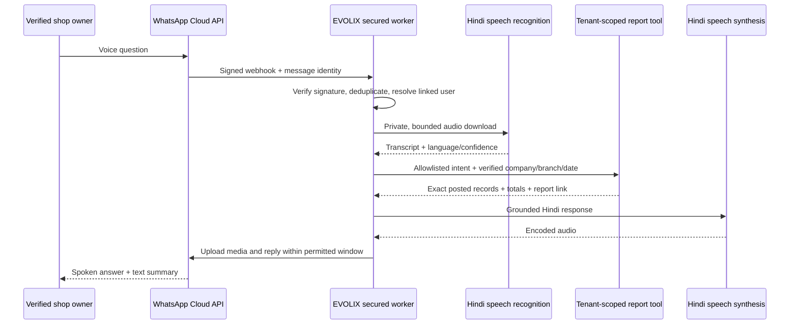

# EVOLIX Hindi voice assistant

Status: design and implementation plan, not an active WhatsApp integration. No Meta account, verified sender number, webhook credentials or deployed speech worker is configured. No customer messages were sent during development.

## Experience for an older shop owner

After a one-time verified account connection, the owner opens the EVOLIX WhatsApp chat and records a normal voice message. Start with two dependable questions:

- “आज कितने लोगों को उधार दिया?” / “Aaj kitne logon ko udhaar diya?”
- “आज कौन सा नया माल आया?” / “Aaj kaunsa naya maal aaya?”

The assistant replies in slow, clear Hindi audio, with a short text copy and a link to the underlying report. An **illustrative** response is: “आज 4 ग्राहकों को कुल 3,250 रुपये नया उधार दिया। सबसे बड़ा उधार 1,200 रुपये है। पूरी सूची भेज दूँ?” These are example values, not EVOLIX business data. Distinguish new credit today from old outstanding dues and received payments. For incoming stock, distinguish a newly created catalog item from physically received, posted purchase stock.

## Architecture

The LLM interprets the question into a small JSON schema, for example `{intent:"NEW_CREDIT_TODAY",date:"2026-10-07"}`. Validate intent and date; never let it supply company/user/branch IDs, SQL, Prisma filters, filesystem paths or arbitrary URLs. Unknown or ambiguous questions get a clarification. Financial totals and distinct customer counts are calculated by EVOLIX from posted invoices and immutable payment allocations, not by the model. India business-day boundaries come from the existing date utility. Returns/reversals are accounted for explicitly in each report definition.

## Models without a per-request model API fee

| Stage | Candidate | Practical reason / conditions |
|---|---|---|
| Transcription | Whisper multilingual through [faster-whisper](https://github.com/SYSTRAN/faster-whisper) | Self-hosted, quantized CPU/GPU execution. Start with multilingual small/medium and compare noisy Hindi/Hinglish recordings; do not use English-only `.en` checkpoints. Check pinned checkpoint license as well as engine license. |
| Intent understanding | [Qwen3-4B](https://huggingface.co/Qwen/Qwen3-4B) | Apache 2.0 model with multilingual support; self-host a quantized checkpoint via a private inference service. Use constrained JSON, short output and deterministic tool execution. Benchmark Hindi names, dates and negation. |
| Hindi reply audio | [AI4Bharat Indic Parler-TTS](https://huggingface.co/ai4bharat/indic-parler-tts) | Apache 2.0, Hindi voices and adjustable speech style. Model access currently requires accepting its access conditions. Use a slow clear speaker preset and pinned revisions. |

The Parler model card recommends newer [Indic-Speak](https://huggingface.co/bodhan-ai/indic-speak), but its model card labels the license “other.” Review its full commercial terms before switching; “downloadable” does not prove commercial use is unrestricted. Compare it with Parler on real shop-owner recordings before selecting it.

“Free model” means no mandatory per-token hosted-model fee when you host permitted weights. Servers/GPU, storage, bandwidth, monitoring and operator time still cost money. Free developer inference tiers have changing quotas and no assumed production availability. Do not send customer ledgers to anonymous public model demos. Keep a small self-hosted report-only pilot; a local computer is adequate for evaluation, not a dependable always-on SaaS server.

Meta's [official pricing page](https://business.whatsapp.com/products/platform-pricing) describes message categories, customer-service windows and message charges. Check the current India rate card in your Meta account before budgeting; an open model does not make WhatsApp delivery or a third-party BSP free. Do not promise unlimited free replies.

## Secure implementation stages

1. Provision a Meta business app with the WhatsApp product and a test sender/recipient. Complete business/number verification and production access separately. Use the official Cloud API, not browser scraping or personal WhatsApp automation.
2. Add `WhatsAppAccountLink` with `company_id`, `branch_id`, `user_id`, verified `wa_id`, consent time, revocation time and unique active identity policy. Link through an authenticated owner flow and an expiring single-use challenge sent to that number; never infer ownership from a typed phone number. Allow immediate unlink/revoke and human recovery after a lost phone.
3. Verify webhook GET challenge with a secret verify token. Verify POST `X-Hub-Signature-256` against the **raw** bytes and Meta app secret using timing-safe comparison. Validate configured app/phone-number identity. Store incoming message ID under a unique constraint, enqueue transactionally, acknowledge quickly, retry worker jobs with bounds. Duplicate callbacks must not repeat ERP operations or send uncontrolled duplicate replies.
4. Resolve persisted active user/membership, subscription, feature and permission on every message; do not reuse a stale session forever. A cashier must not learn owner reports just because their phone is linked. Suspended/revoked links receive an access explanation without business figures. Initially enable owners only and read-only aggregate reports.
5. Fetch media using provider-returned IDs, approved Meta hosts, bounded download size/duration and MIME/content validation. Reject redirect/SSRF attempts and malformed audio. Cap a voice note at an agreed duration, e.g. 60 seconds, and process in a separate constrained worker.
6. Run ASR on a private service. Ask for clarification on low confidence, ambiguous names or dates; never guess a money amount. Pass only transcript and tool schema to the intent model. Keep ERP rows outside the model unless specifically needed and allowed.
7. Implement `NEW_CREDIT_TODAY` and `STOCK_RECEIVED_TODAY` tools with server-derived identity and authoritative posting filters. Return exact totals, counts, date range, source record references and bounded detail lists. Offer “send full list” as a separate authorized action; avoid reading dozens of private customer balances in a public place.
8. Render a deterministic Hindi response from tool output, or validate every number in any model narration. TTS generates speech; convert to a currently supported WhatsApp audio format, upload privately and send an audio reply plus text. Verify actual voice-note presentation on Android: do not call a generic audio attachment a native voice note without testing Meta's current payload support.
9. Delete raw media/transcripts under an explicit approved retention policy. Redact logs; store request IDs, tool names, status and processing latency rather than full voice content or customer balances. Add quota, queue-depth, inference-timeout and provider-delivery alerts; provide a human support option.
10. Test signed/forged webhook, replay, wrong phone/app, cross-tenant IDs, revoked user/link, prompt injection, low confidence, Hindi/Hinglish, midnight boundaries, returns, split credit, duplicate reply, provider timeout, media deletion and recovery. Pilot with older shop owners and measure comprehension, transcription error and time to answer.

## Boundaries for the first release

Read-only reporting first. No voice-created invoice, stock adjustment, supplier payment, account change or money transfer until an explicit confirmation and persisted idempotency workflow is designed and tested. Never train on tenant data by default. Do not claim a bank payment from a QR scan or a spoken statement.

Next practical milestone: a local Hindi voice → report → Hindi audio demonstration using disposable tenant data, then Meta test-number integration after the operator creates the required accounts. Production WhatsApp remains NOT CONFIGURED until that integration and acceptance pass.
